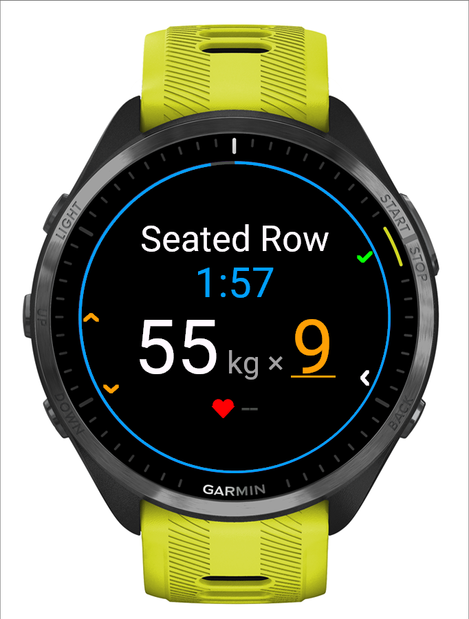
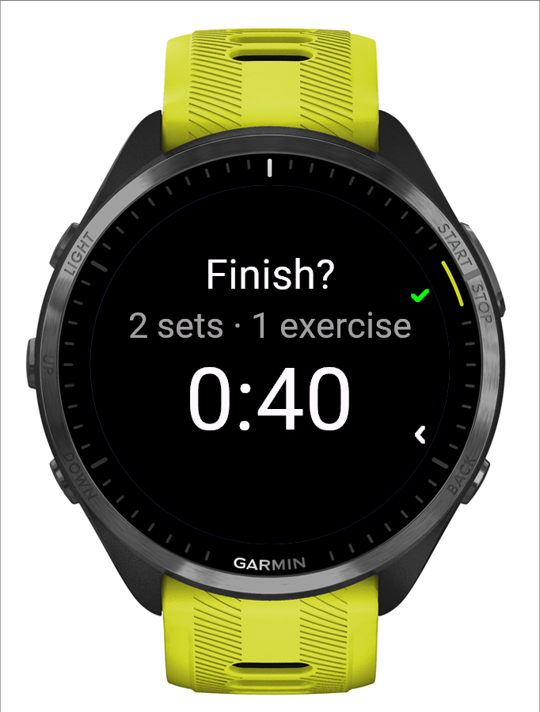

# NextSet: Unofficial Liftosaur Companion

**Log your [Liftosaur](https://www.liftosaur.com) workouts on your Garmin watch.**

NextSet is a Connect IQ watch app for strength training. It downloads the current week of your Liftosaur program to the watch. You log every set with the buttons, and the finished workout goes straight back to Liftosaur, so progression, 1RMs and your next day update as if you had used the Liftosaur app. Garmin Connect still gets an activity with heart rate and duration.

No phone in your hand at the gym, no second app, no server in between.

> NextSet is an independent hobby project. It is not affiliated with or endorsed by Liftosaur or Garmin.

  
  
  
  

Forerunner 965 simulator with a made-up program (<code>monkey.demo.jungle</code>).

## Features

- **Your Liftosaur program on the watch.** Sync downloads the days of the current week (up to eight) with per-set targets, warmups, rep ranges, rest timers, supersets and timed sets. After a sync you can train without the phone.
- **One press per set.** UP/DOWN adjust the reps (the weight is in **Change weight**), START logs the set and starts the rest. The rest is a blue ring around the screen with the time left, and the centre already shows the next set's weight, so you can load the bar or move the pin. A medium vibration comes 10 s before the rest ends, a long one when it is over, and the ring turns green while the overtime counts up.
- **Heart rate.** The live heart rate sits at the bottom of the set and rest screens; the summary shows the workout's average and maximum.
- **Kilograms or pounds.** Weights stay in the unit your Liftosaur account uses (`kg` or `lb`), on the watch and in the upload.
- **Programs that ask for values.** Sets that log an RPE ask for it right after the set, and exercises with prompted variables (Liftoscript `state.name+`) ask for each value after the last set. Both start at the program's suggestion: START saves, BACK keeps the suggestion.
- **Warmups, supersets, timed sets.** Warmups come from the program and upload as Liftosaur warmup sets. Supersets alternate automatically. Timed sets (planks, dead bugs) count down and log the held time; one-sided timed sets record the left and then the right side.
- **Change things on the fly.** Change the weight of the next set, edit or delete the last set, add a set or skip warmups. The weight step is automatic: 2.5 kg or 5 lb.
- **Direct upload to Liftosaur.** Up to four finished workouts are queued and uploaded over the phone connection. An interrupted upload retries safely, and nothing is sent twice. If the program changed since you trained, the upload stops and tells you, instead of writing to the wrong day.
- **Garmin activity.** Each workout is also a Training activity in Garmin Connect, with heart rate, duration and one lap per set.
- **Crash safe.** The workout is saved after every set. If the watch or app restarts, you continue where you were.

## Supported watches

Garmin watches with five buttons and Connect IQ 5 or newer:

| Family | Models |
| --- | --- |
| Forerunner | 165, 170, 255 (all variants), 265 / 265S, 570, 70, 955, 965, 970 |
| fēnix | 7 / 7 Pro (S, X, Solar), 8 (43 / 47 / 51 mm, Pro, Solar), 9 (all), E |
| Other | epix (Gen 2) and epix Pro, Enduro 3, MARQ (Gen 2), Instinct 3 AMOLED, Instinct Crossover AMOLED, D2 Mach 1 / 2 / 2 Pro, Descent Mk3 and G2 |

NextSet is developed and used daily on a **Forerunner 965**. All other models build and have the same button layout, and the Home screen has been started in the simulator on a sample of them (including Forerunner 255S, fēnix 7S and Instinct 3 AMOLED), but none has been tested on a real watch yet. Reports are welcome (see [Contributing](#contributing)).

Not supported: two-button touch watches (Venu, vívoactive), Connect IQ 3 watches (fēnix 6, Forerunner 245/745/945, MARQ Gen 1) and small-memory watches such as Instinct 2 / 3 Solar and Instinct E.

## What you need

- A supported Garmin watch, paired with Garmin Connect on your phone (sync and upload use the phone's connection).
- A Liftosaur account with **Liftosaur Premium** (needed for API access) and an API key (`lftsk_…`). See the [Liftosaur API docs](https://www.liftosaur.com/doc/api).
- A Liftosaur program whose days do not depend on prompted values (see [Limitations](#limitations)).

## Install

Install NextSet from the **Connect IQ Store**: open the Connect IQ app on your phone, search for "NextSet" and install it on your watch. Store installs update automatically, and your workouts and settings are kept.

The Connect IQ Store is the only way to install NextSet; GitHub releases carry the release notes, not build files. Developers can build and run it from source (see [CONTRIBUTING.md](CONTRIBUTING.md)).

## Set up

1. **Enter your key.** Open NextSet, then **Menu → Settings → Liftosaur key**, and type your API key. It is stored only in the watch's app storage and shown masked (`lftsk_…ab12`). **Test key** checks it, **Clear key** removes it.
2. **Sync.** With the phone nearby, choose **Menu → Settings → Sync routines**, or press START on Home when nothing is synced yet. Home shows "Synced N days" when done.
3. **Train.** Choose the day with UP/DOWN on Home and press START.

Hold UP to open the menu anywhere. The small icons at the screen edge show what each button does. Every workout screen keeps the same places: the exercise at the top, set dots (or the rest time) below it, weight and reps in the middle, heart rate at the bottom. Yellow and underlined is what UP/DOWN change.

## Using NextSet

- **Log a set:** UP/DOWN change the reps, START logs the set and starts the rest. A second press within 800 ms is ignored. If the program asks for an RPE or prompted values, a question screen follows (UP/DOWN change, START saves, BACK keeps the suggestion).
- **Change the weight (buttons only):** hold UP and choose **Change weight** (the first item; **Change time** for a timed set, nothing for bodyweight, whose reps change on the set screen). The weight opens big, yellow and underlined: UP/DOWN change it by 2.5 kg or 5 lb (fast presses speed up, two then four steps per press), START saves and closes, BACK closes without saving. A changed weight carries over to the following sets unless the program gives them a different weight. Reps can be changed straight on the set screen with UP/DOWN.
- **Fix the last set:** in the same menu **Edit last set** (showing its values) and **Delete set N** follow. **Edit last set** opens the weight and reps big with the weight framed: UP/DOWN pick a field, START enters it (yellow and underlined), UP/DOWN change it, START keeps it, BACK restores the old value. BACK from the choice closes the editor and saves.
- **Timed sets:** START starts the countdown, START again logs the held time, BACK pauses. A one-sided set shows "Left side", then "Right side": hold each side and press START after each.
- **Overview:** BACK from an exercise shows the exercises one at a time: the name, "Exercise 2/8", the sets done big ("2/3") and the next set ("55 kg × 9"). UP/DOWN browse, START trains the shown exercise, so you can go out of order.
- **Finish:** the last item of the hold-UP menu is **Finish workout** (it is also offered after the last set, and BACK on the Overview opens it). The review shows the workout time, sets and exercises done. START saves; BACK opens a choice between **Keep working** (selected first) and **Discard** (UP/DOWN move, START confirms, BACK returns to the review). With no set logged the review can only be discarded. The summary then shows the upload status live. Discarding throws the workout away: no history, no upload, and the Garmin activity is discarded. These screens, and the confirmations for deleting a set or clearing the upload queue, answer only to the buttons.
- **History:** the last four workouts, one per page, with a check for the Garmin activity and the Liftosaur upload. START shows the sets.
- **Touch is ignored.** NextSet is operated with the five buttons only, so a wet or sweaty screen cannot change a weight or log a set. (The system menus, such as the hold-UP menu and Settings, are Garmin's own.)
- **When something goes wrong:** pending uploads retry after 2, 5 and 10 minutes while the app is open and at every launch. **Settings → Retry workout upload** retries now. **Skip this upload** and **Clear upload queue** remove stuck jobs; local history is kept.

## Limitations

- RPE, prompted variables, one-sided timed sets, pounds, unilateral rep counts and timed-set progression follow Liftosaur's API documentation but have not been confirmed with a real workout upload yet.
- Heart rate on screen comes from the running Garmin activity; the summary's average and maximum are lost if the app restarts during the workout (the Garmin activity keeps them).
- The Garmin activity is a Training activity with NextSet's own lap fields. It does not create Garmin's native strength sets, and Garmin Connect does not display the custom fields.
- Only the Forerunner 965 has been tested on real hardware. Details are in [docs/DEVICE_TESTS.md](docs/DEVICE_TESTS.md).

## Privacy and security

- NextSet talks only to `https://www.liftosaur.com/api/v1`, through Garmin's phone connection. There is no NextSet server, tracking or analytics.
- Your API key stays in the watch's app storage. It is never shown in full, logged or put in a setting that syncs to the phone. Treat it like a password: it gives full access to your Liftosaur account. If it leaks, delete it in Liftosaur and create a new one.
- Workout history on the watch stays on the watch, apart from what is uploaded to Liftosaur and the Garmin activity.

## FAQ

**Does it work without the phone?** Logging does, once routines are synced. Sync and upload need the phone's connection. Finished workouts wait in the queue until the phone is back.

**I use [liftosaur2garmin](https://github.com/Zettt/liftosaur2garmin). Does that work?** It should from NextSet 0.3.6 on, but this has not been confirmed with a real upload yet. Up to 0.3.5 NextSet added a note to every workout, which made liftosaur2garmin's parser fail; since 0.3.6 it adds a note only for a replaced exercise or extra warmups. The same parser still fails on any Liftosaur workout that has a note, including notes you write in the Liftosaur app.

**Why five buttons only?** Every action is mapped to UP, DOWN, START, BACK and the menu, so it works with sweaty hands and gloves. Touch-only watches would need their own controls.

## Contributing

Bug reports, watch reports and pull requests are welcome. See [CONTRIBUTING.md](CONTRIBUTING.md) for setup, build, tests and conventions.

## License

[MIT](LICENSE) © 2026 Tristan Marl
