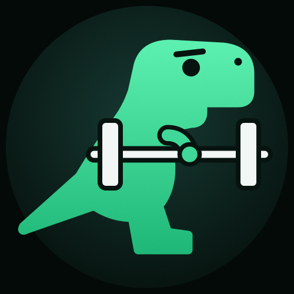
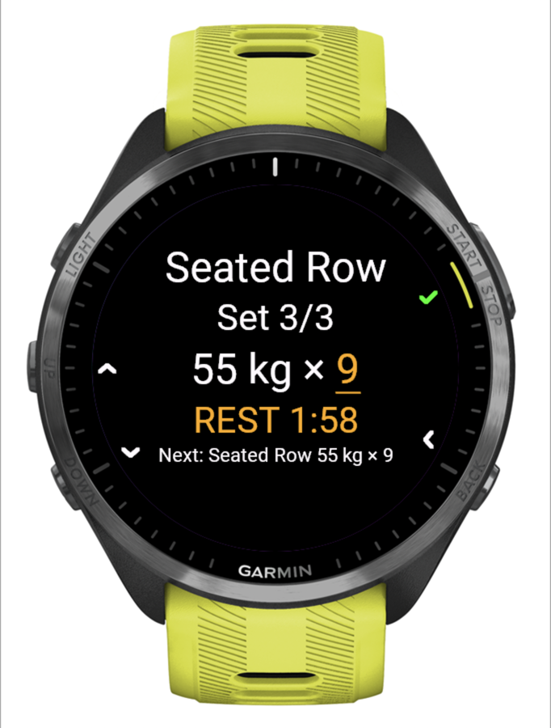
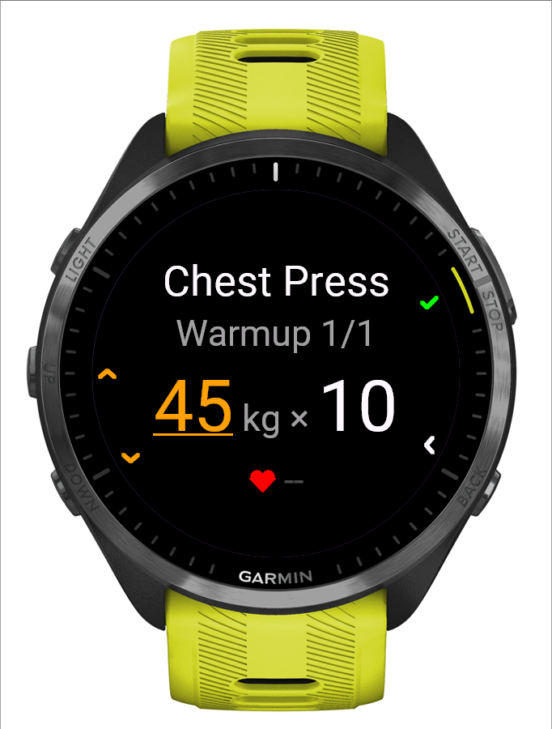
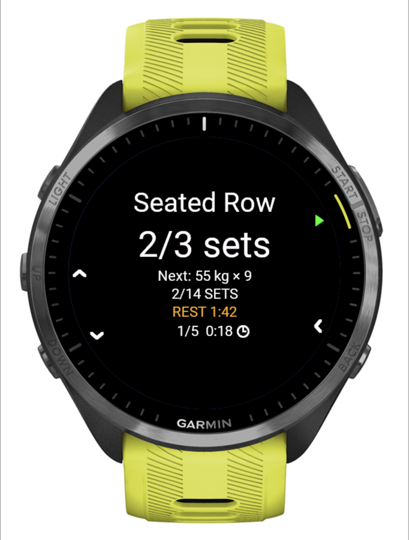
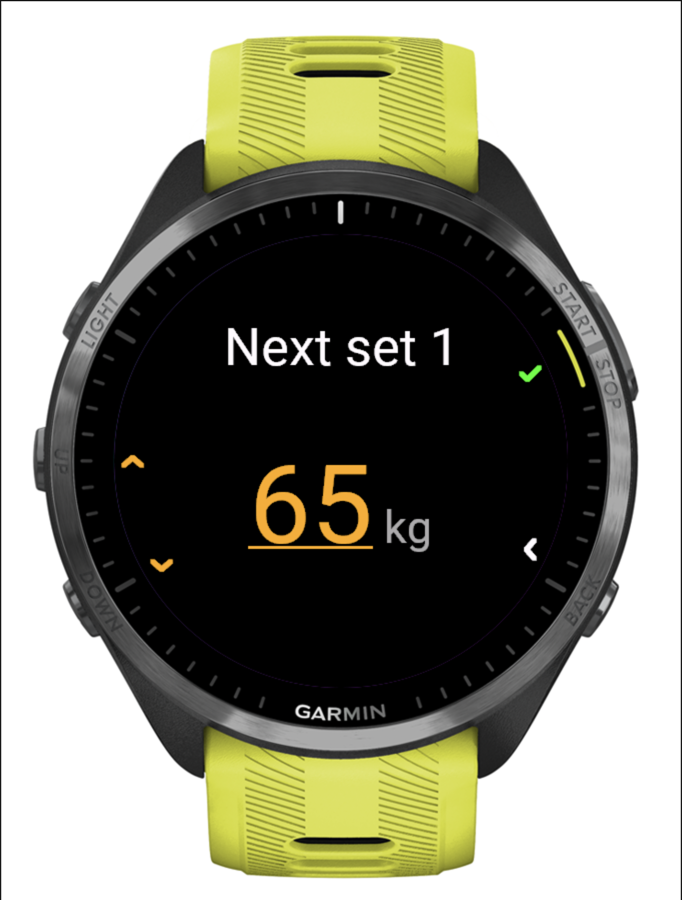

# NextSet: Unofficial Liftosaur Companion

**Log your [Liftosaur](https://www.liftosaur.com) workouts on your Garmin watch.**

NextSet is a Connect IQ watch app for strength training. It downloads the current week of your Liftosaur program to the watch. You log every set with the buttons, and the finished workout goes straight back to Liftosaur, so progression, 1RMs and your next day update as if you had used the Liftosaur app. Garmin Connect still gets an activity with heart rate and duration.

No phone in your hand at the gym, no second app, no server in between.

> NextSet is an independent hobby project. It is not affiliated with or endorsed by Liftosaur or Garmin.

  
  
  
  

Forerunner 965 simulator with a made-up program (<code>monkey.demo.jungle</code>).

## Features

- **Your Liftosaur program on the watch.** Sync downloads the days of the current week (up to eight) with per-set targets, warmups, rep ranges, rest timers, supersets and timed sets. After a sync you can train without the phone.
- **One press per set.** UP/DOWN adjust the reps (or the load, switched from the menu), START logs the set and starts the rest timer. A short vibration warns 10 s before the rest ends, and an overtime clock counts up after it.
- **Warmups, supersets, timed sets.** Warmups come from the program and upload as Liftosaur warmup sets. Supersets alternate automatically. Timed sets (planks, dead bugs) count down and log the held time.
- **Change things on the fly.** Change the load, edit or delete the last set, add a set, skip warmups, skip or replace an exercise, or change the weight step (0.5 / 1 / 2.5 / 5 kg).
- **Direct upload to Liftosaur.** Up to four finished workouts are queued and uploaded over the phone connection. An interrupted upload retries safely, and nothing is sent twice. If the program changed since you trained, the upload stops and tells you, instead of writing to the wrong day.
- **Garmin activity.** Each workout is also a Training activity in Garmin Connect, with heart rate, duration and one lap per set.
- **Crash safe.** The workout is saved after every set. If the watch or app restarts, you continue where you were.

## Supported watches

Garmin watches with five buttons and Connect IQ 5 or newer:

| Family | Models |
| --- | --- |
| Forerunner | 165, 170, 255 (all variants), 265 / 265S, 570, 70, 955, 965, 970 |
| fēnix | 7 / 7 Pro (S, X, Solar), 8 (43 / 47 / 51 mm, Pro, Solar), 9 (all), E |
| Other | epix (Gen 2) and epix Pro, Enduro 3, MARQ (Gen 2), Instinct 3 AMOLED, Instinct Crossover AMOLED, D2 Mach 1 / 2 / 2 Pro, Descent Mk3 and G2 |

NextSet is developed and used daily on a **Forerunner 965**. All other models build, start in the simulator and have the same button layout, but have not been tested on a real watch yet. Reports are welcome (see [Contributing](#contributing)).

Not supported: two-button touch watches (Venu, vívoactive), Connect IQ 3 watches (fēnix 6, Forerunner 245/745/945, MARQ Gen 1) and small-memory watches such as Instinct 2 / 3 Solar and Instinct E.

## What you need

- A supported Garmin watch, paired with Garmin Connect on your phone (sync and upload use the phone's connection).
- A Liftosaur account with **Liftosaur Premium** (needed for API access) and an API key (`lftsk_…`). See the [Liftosaur API docs](https://www.liftosaur.com/doc/api).
- A Liftosaur program whose days do not depend on prompted values (see [Limitations](#limitations)).

## Install

NextSet is not in the Connect IQ Store yet. Install it by sideloading:

1. Download `NextSet-X.Y.Z-sideload.zip` from the [latest release](https://github.com/tristanmarl/NextSet/releases).
2. Unzip it and pick the file for your watch, for example `NextSet-X.Y.Z-fr965.prg` or `NextSet-X.Y.Z-fenix7.prg`. The device ids are listed in [`manifest.xml`](manifest.xml).
3. Connect the watch by USB and copy the file into `GARMIN/APPS` on the watch. On Windows the watch appears as a drive; on macOS use an MTP tool such as [OpenMTP](https://openmtp.ganeshrvel.com).
4. Disconnect the watch. NextSet appears in the app list.

To update, copy the new `.prg` over the old one. Your workouts and settings are kept.

## Set up

1. **Enter your key.** Open NextSet, then **Menu → Settings → Liftosaur key**, and type your API key. It is stored only in the watch's app storage and shown masked (`lftsk_…ab12`). **Test key** checks it, **Clear key** removes it.
2. **Sync.** With the phone nearby, choose **Menu → Settings → Sync routines**, or press START on Home when nothing is synced yet. Home shows "Synced N days" when done.
3. **Train.** Choose the day with UP/DOWN on Home and press START.

Hold UP to open the menu anywhere. The small icons at the screen edge show what each button does; the UP/DOWN arrows turn yellow while they change the load.

## Using NextSet

- **Log a set:** UP/DOWN change the reps, START logs the set and starts the rest. A second press within 800 ms is ignored.
- **Change the load:** hold UP and choose **Change load** (the first item). The weight turns yellow and UP/DOWN change it by your weight step; fast presses speed up (two, then four steps per press). **Change reps** in the same place switches back. Logging a set switches back to reps. A changed load carries over to the following sets unless the program gives them a different weight. On touch watches you can also tap the weight.
- **Fix the last set:** hold UP for the menu: **Edit last set** (showing its values) and **Delete set N** are at the top. The editor shows load and reps together (hold UP switches between them, START saves, BACK cancels).
- **Timed sets:** START starts the countdown, START again logs the held time, BACK pauses.
- **Overview:** BACK from an exercise shows all exercises with progress and the elapsed time. Pick any exercise to train out of order.
- **Finish:** **Menu → Finish workout**. The summary shows the upload status live. **Cancel workout** throws the workout away: no history, no upload, and the Garmin activity is discarded.
- **History:** the last four workouts, with the Liftosaur upload state of each.
- **When something goes wrong:** pending uploads retry after 2, 5 and 10 minutes while the app is open and at every launch. **Settings → Retry workout upload** retries now. **Skip this upload** and **Clear upload queue** remove stuck jobs; local history is kept.

## Limitations

- Prompted variables in Liftosaur programs (`promptedVars`) are not asked on the watch, so programs that need them cannot be synced.
- Unilateral rep counts (left/right) and timed-set progression have not been confirmed against Liftosaur on a real workout yet.
- The Garmin activity is a Training activity with NextSet's own lap fields. It does not create Garmin's native strength sets, and Garmin Connect does not display the custom fields.
- Only the Forerunner 965 has been tested on real hardware. Details are in [docs/DEVICE_TESTS.md](docs/DEVICE_TESTS.md).

## Privacy and security

- NextSet talks only to `https://www.liftosaur.com/api/v1`, through Garmin's phone connection. There is no NextSet server, tracking or analytics.
- Your API key stays in the watch's app storage. It is never shown in full, logged or put in a setting that syncs to the phone. Treat it like a password: it gives full access to your Liftosaur account. If it leaks, delete it in Liftosaur and create a new one.
- Workout history on the watch stays on the watch, apart from what is uploaded to Liftosaur and the Garmin activity.

## FAQ

**Does it work without the phone?** Logging does, once routines are synced. Sync and upload need the phone's connection. Finished workouts wait in the queue until the phone is back.

**I use [liftosaur2garmin](https://github.com/Zettt/liftosaur2garmin). Does that work?** Yes, after NextSet 0.3.4. Up to 0.3.4 NextSet added a note to every workout, which made liftosaur2garmin's parser fail; it now adds a note only for a replaced exercise or extra warmups. The same parser still fails on any Liftosaur workout that has a note, including notes you write in the Liftosaur app.

**Why five buttons only?** Every action is mapped to UP, DOWN, START, BACK and the menu, so it works with sweaty hands and gloves. Touch-only watches would need their own controls.

## Contributing

Bug reports, watch reports and pull requests are welcome. See [CONTRIBUTING.md](CONTRIBUTING.md) for setup, build, tests and conventions.

## License

[MIT](LICENSE) © 2026 Tristan Marl
